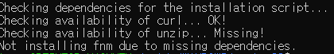
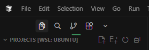

> 개발은 주로 맥북이나 맥미니로 하고, 개인 데스크톱은 게임용이라 개발 세팅은 하기 싫었다.  
> 근데 개발할 일이 생길 때마다 회사 PC에 원격으로 붙거나 맥을 켜서 환경부터 잡아야 했다. 일을 하기 위해 일을 해야 하는 느낌..?  
> Hyper-V는 너무 투머치라 찾다 보니 WSL을 알게 됐고, 이 정도는 양보할 만해서 세팅해봤다.

## WSL2

Windows PC에서 리눅스 환경을 쓰기 위해 WSL2를 세팅했다.  
가상머신을 따로 띄우는 게 아니라 Windows 위에서 바로 리눅스를 돌릴 수 있어서  
개발 환경은 리눅스, 에디터는 Windows 이렇게 나눠서 쓸 수 있다.

## WSL 설치

PowerShell을 관리자 권한으로 열고 아래 명령어를 실행한다.

```powershell
wsl --install
```

설치가 끝나면 PC를 재시작한다.  
원래는 재시작 후에 명령 창이 뜨면서 리눅스 계정 아이디/비밀번호를 입력하라고 안내가 나온다고 한다.

### 재시작 후에 아무것도 안 뜬다면

나는 재시작하고 나서 아무 창도 안 떴다.  
재시작 과정에서 Ubuntu가 설치되지 않아서 생기는 경우라고 해서, Ubuntu를 직접 설치했다.

```powershell
wsl --install -d Ubuntu
```

설치가 끝나면 그때 계정 생성 안내가 나온다.

## Node 설치 (fnm)

Node 버전 관리는 fnm을 사용했다.

### unzip 먼저 설치하기

바로 fnm 설치 스크립트를 돌렸더니 아래처럼 에러가 났다.



Ubuntu를 막 설치한 상태면 압축 해제 도구(unzip)가 없어서 fnm 설치가 실패한다.  
unzip부터 설치해주자.

```bash
sudo apt update && sudo apt install -y unzip
```

### fnm 설치

```bash
curl -fsSL https://fnm.vercel.app/install | bash
```

설치가 끝나면 쉘 설정을 다시 불러와야 `fnm` 명령어가 잡힌다.

```bash
source ~/.bashrc
```

### Node 설치

```bash
fnm install --lts # LTS 버전 설치
node -v # 작성 당시 v26.13.0 설치됨
```

## 에디터 연결하기

여기서 헷갈렸던 부분인데, 코드 에디터는 리눅스 안에 설치하는 게 아니라 **Windows에 설치**한다.  
그리고 WSL 터미널에서 프로젝트 경로로 이동한 다음 에디터를 실행하면 된다.

```bash
# 사용하는 에디터로 택 1
code .
cursor .
```

명령어를 실행하면 WSL 쪽에 필요한 서버를 알아서 다운로드하고,  
완료되면 에디터가 켜진다. 평소 로컬에서 에디터 켜는 것과 똑같이 켜진다.

> VS Code는 WSL 확장을 따로 설치해야 한다고 한다.  
> 나는 Cursor를 쓰는데 자체적으로 포함되어 있어서 그냥 명령어만 실행했다.



연결이 되면 이렇게 프로젝트 경로에 `WSL: UBUNTU`로 표기되는 걸 확인할 수 있다.

## 참고 자료

- [WSL 설치 - Microsoft Learn](https://learn.microsoft.com/ko-kr/windows/wsl/install)
- [fnm GitHub](https://github.com/Schniz/fnm)
- [VS Code에서 WSL 사용하기](https://code.visualstudio.com/docs/remote/wsl)
